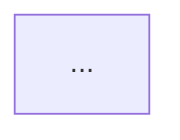

# Template — `flow` (as-is / to-be business flow)

Locked format for `sse-ba --mode flow`. Headings may be translated; the structure may not.
Rules and when to use: [`../SKILL.md` → Modes](../SKILL.md#modes). Filled example:
[`../references/worked-examples.md`](../references/worked-examples.md) §4.

Words + Mermaid. As-is built from evidence, step by step with sources; to-be only when a change
is requested, with every differing step marked. BPMN 2.0 semantics: one lane per actor, explicit
exception paths, timers for deadlines.

````markdown
# Business Flow — <flow name>

## As-is



### Step by step
| Step | Business description | Source |
|---|---|---|
| 1 | ... | ... |

### Key branches and exceptions
- ...

## To-be (only when a change is requested)


### Differences from as-is
| Step | As-is | To-be | Reason |
|---|---|---|---|

## Sources checked
- ...

BA Output: <≤ 25 words>
````
