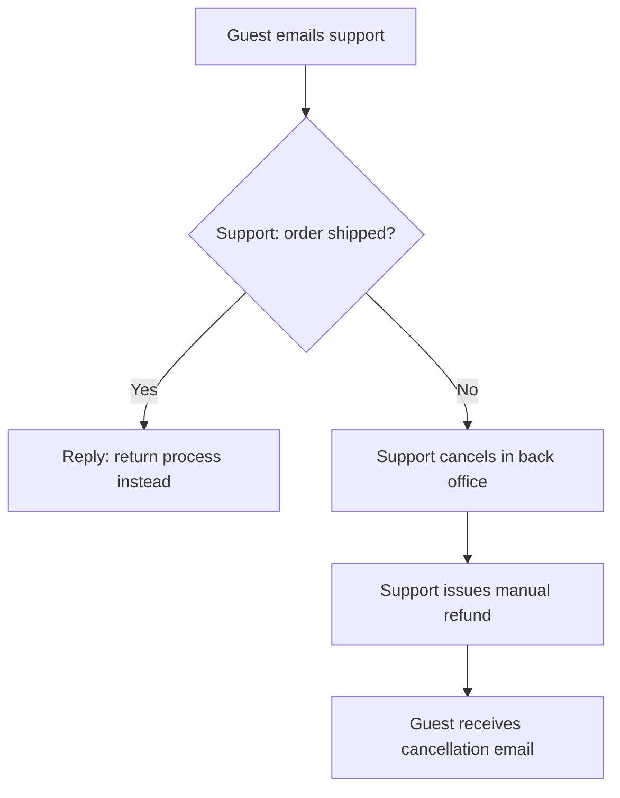
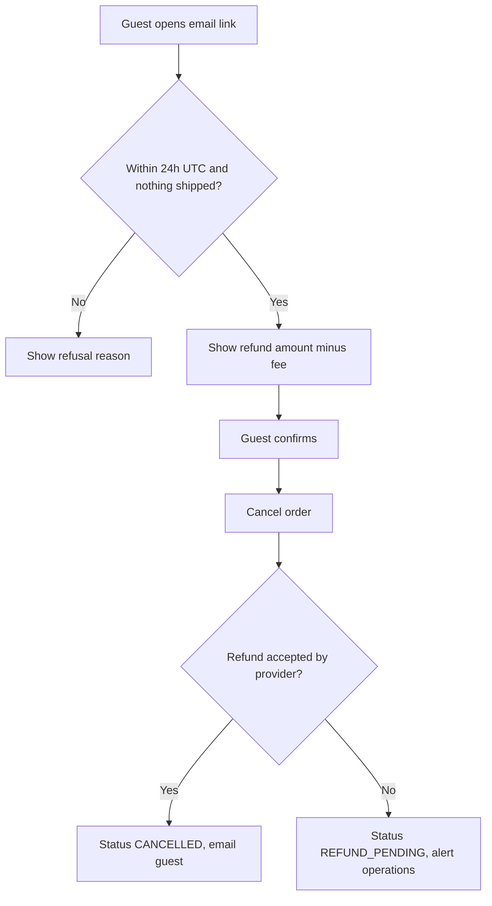

# sse-ba — Worked examples

Filled examples for every mode, following the locked formats in [`../assets/`](../assets/)
(templates) and the rules in [`../SKILL.md`](../SKILL.md#modes).
All tickets, files and rules below are **fictional** (an e-commerce store) — copy the structure
and the depth of reasoning, not the content.

**Shared input (examples 1–5):** ticket `PROJ-9001` — "Let guest customers (no account) cancel an
order from the confirmation email within 24 hours and get an automatic refund." AC: (1) the link
works for 24h from order creation *(store local time)*; (2) shipped orders cannot be cancelled;
(3) refund = amount paid minus the cancellation fee, shown before confirming. Latest product-owner
comment: "24h is measured in UTC, not store local time."

## Contents

1. `diag` — stuck discussion about the refund rule
2. `analyze` — gap analysis of PROJ-9001
3. `spec` — stories, rules (with decision table) and Gherkin AC
4. `flow` — as-is vs to-be cancellation flow
5. `impact` — effect of the new cancellation rule

---

## 1. `diag`

**Context:** the team is debating whether the refund should include shipping costs.

```
BA Diag — whether guest self-cancel refunds include shipping

1. Partial refunds are undefined — an order with one item already shipped has no rule, so the link either refunds too much or fails. → Allow self-cancel only when no item has left the warehouse.
2. Refund currency is unstated — orders paid in a foreign currency may be refunded at today's rate, creating a visible loss for the customer. → Refund the exact amount and currency captured at payment (ISO 4217 code on every amount).
3. Refund failure after cancellation — warehouse cancels but the payment provider rejects the refund, leaving a cancelled order with no money back. → Add a "refund pending" state with an operations alert.

Decisive question: Is the fee a fixed policy per order, or does it differ per product category?

BA Output: 3 gaps — partial shipment, refund currency, refund failure state. Blocking: fee rule owner undecided.
```

---

## 2. `analyze`

```
## Business Analysis — PROJ-9001

### 1. What is requested (in the source's own words)
Guest customers can cancel from the confirmation email within 24h of ordering, if the order has not shipped, and receive an automatic refund minus the cancellation fee, which is shown before they confirm.

### 2. Current behaviour (as-is)
- Guests cannot self-cancel; they email support, who cancel in the back office — [source: docs/support/cancellation-runbook.md §2]
- Registered customers can cancel from "My orders" while status is PLACED or PAID — [source: src/orders/OrderPolicy.ts:41]
- A cancellation fee of 5% applies to all orders — [source: src/orders/fees.ts:12; tests/orders/fees.test.ts:30]
- Refund timing and currency rules — ASSUMPTION — no source found; needs confirmation from finance.

### 3. Gaps found

#### #1 — Ambiguous — Which clock defines "24 hours"
- **Evidence:** AC 1 "24h from order creation (store local time)" ↔ latest PO comment "measured in UTC".
- **Reasoning:** the two readings differ by the store's UTC offset and DST; development and testing may implement different windows, and customers near the edge are refused a cancellation they were promised.
- **BA proposal:** the latest comment wins — measure 24h from the order-created timestamp in UTC (ISO 8601 with offset); update AC 1 before development starts.
- **Decide with:** PO — "Confirm AC 1 becomes 'within 24h of the order-created timestamp, UTC'?"

#### #2 — Missing rule — Refund fails after the order is cancelled
- **Evidence:** "automatic refund" ↔ as-is: refunds are issued manually by support [runbook §3].
- **Reasoning:** cancellation and refund are two systems; a partial failure leaves the customer without money and nobody notified.
- **BA proposal:** new state REFUND_PENDING, operations alert, customer notified "refund in progress"; add as AC 4.
- **Decide with:** PO + finance — "Who owns a failed refund, and within what time must it be resolved?"

#### #3 — Blind spot — Orders paid in a foreign currency
- **Evidence:** AC 3 "amount paid minus fee" ↔ as-is: store supports 3 currencies [src/payments/currency.ts:8].
- **Reasoning:** refunding at a new exchange rate changes the amount the customer sees.
- **BA proposal:** refund the captured amount and currency; fee computed in the same currency, rounded per the currency's minor units.
- **Decide with:** finance — "Refund in the captured currency, fee rounded half-up to minor units?"

### 4. Conclusion
- Blocking: #1 (defines the feature), #2 (money). Non-blocking: #3 (can be built in parallel, decide before release).
- Readiness: significant gaps remain.
- Next step: `--mode spec` once #1 and #2 are decided.

### Sources checked
- docs/support/cancellation-runbook.md, src/orders/OrderPolicy.ts, src/orders/fees.ts, tests/orders/fees.test.ts, src/payments/currency.ts
```

---

## 3. `spec`

```markdown
# Spec — PROJ-9001 Guest self-cancel with automatic refund

## 1. Context & business value
- Current problem: guests must email support to cancel (runbook §2); about a third of support tickets are cancellation requests (support dashboard — needs confirmation).
- Who benefits & how it is measured: guests (time to cancel); support (cancellation tickets per week, target −50%).

## 2. Scope
- In scope: cancel link in the guest confirmation email; fee shown before confirmation; automatic refund; failed-refund handling.
- Out of scope: partial cancellation of single items; registered-customer flow (unchanged); changing the fee policy.

## 3. User stories
> US-01 — As a guest customer, I want to cancel my order from the confirmation email, so that I get my money back without contacting support.
> US-02 — As an operations agent, I want to be alerted when an automatic refund fails, so that the customer is refunded within the service target.

## 4. Business rules
| # | Rule | Origin | Source |
|---|---|---|---|
| BR-01 | Cancellation fee is 5% of the amount paid | as-is kept | src/orders/fees.ts:12 |
| BR-02 | Self-cancel allowed within 24h of the order-created timestamp, UTC | NEW | PO comment on PROJ-9001 |
| BR-03 | Refund is issued in the captured currency, fee rounded to minor units | NEW | finance decision (pending) |

Decision table — may the guest self-cancel? (hit policy: first)

| Within 24h (UTC) | Any item shipped | Final-sale item in order | Outcome |
|---|---|---|---|
| No | – | – | Refused: "cancellation window closed" |
| Yes | Yes | – | Refused: "order already shipped" |
| Yes | No | Yes | Allowed; refund excludes final-sale items |
| Yes | No | No | Allowed; full refund minus fee |

## 5. Acceptance criteria
### US-01
- AC-01: Given a guest order created 2 hours ago that has not shipped, When the guest confirms cancellation from the email link, Then the order status is CANCELLED and a refund of the amount paid minus 5% is issued in the captured currency.
- AC-02: Given a guest order created 24 hours and 1 minute ago (UTC), When the guest opens the link, Then a "cancellation window closed" page is shown and no refund is created.
- AC-03: Given an order already cancelled through the link, When the link is opened again, Then the page states the order is already cancelled and no second refund is created.
### US-02
- AC-04: Given the payment provider rejects the refund, When cancellation completes, Then the order status is REFUND_PENDING, operations receive an alert, and the customer is told the refund is in progress.

## 6. Assumptions & open questions
- ASSUMPTION: final-sale items remain non-refundable (store policy page) — PO to confirm.
- Question: service target for resolving REFUND_PENDING — ask finance.

## 7. Related business impact (summary)
- Reporting & reconciliation: new REFUND_PENDING status must appear in the daily refund report.

## 8. Technical references (for developers)
- src/orders/OrderPolicy.ts (status checks), src/orders/fees.ts (fee), payment refund endpoint in src/payments/.

## Sources checked
- As in the analysis above, plus the PO comment on PROJ-9001.
```

INVEST check applied: US-01 and US-02 are independent and small; US-02 was split out because
"alert operations" fails *Small* when merged into US-01.

---

## 4. `flow`

````markdown
# Business Flow — Guest order cancellation

## As-is



### Step by step
| Step | Business description | Source |
|---|---|---|
| 1 | Guest writes to support with the order number | runbook §2 |
| 2 | Support checks shipment status | runbook §2 |
| 3 | Support cancels and refunds manually | runbook §3 |

### Key branches and exceptions
- Shipped orders go to the returns process.

## To-be



### Differences from as-is
| Step | As-is | To-be | Reason |
|---|---|---|---|
| Entry | Email to support | Self-service link | Reduce support load |
| Refund | Manual | Automatic with failure state | Speed; partial-failure safety |
````

---

## 5. `impact`

```
## Business Impact — Guest self-cancel within 24h with automatic refund

### The change
Guests cancel unshipped orders from an email link within 24h (UTC) and are refunded automatically minus a 5% fee.

### Impact by area
| Area | Affected | Detail | As-is source |
|---|---|---|---|
| Calculations & money | Yes | Fee computed automatically; rounding per currency minor units must match finance | src/orders/fees.ts:12 |
| Business rules & policies | Yes | New 24h UTC window for guests only | PO comment |
| Customer-facing flows & UI | Yes | New link, refund preview and refusal pages | — |
| State lifecycle | Yes | New REFUND_PENDING status | src/orders/OrderPolicy.ts:41 |
| Integrations & third parties | Yes | Warehouse must stop picking; payment provider refund call | — |
| Reporting, finance & reconciliation | Yes | Refund report must include automatic and pending refunds | ASSUMPTION |
| Notifications & communications | Yes | Confirmation email gains the link; new cancellation email | — |
| Security, privacy & compliance | Yes | Link must be single-use and unguessable; no personal data in the URL | — |
| Operations & support | Yes | Fewer tickets; new alert queue for failed refunds | runbook §3 |
| Existing data & migration | No | Only orders created after release get the link; older emails unchanged | — |

### What each stakeholder sees differently
- Customer: self-service cancellation with refund preview / Operations: alerts instead of emails / Finance: new pending status in reconciliation / Warehouse: cancellations arrive without human review.

### Highest risk & recommendation
- A cancellation reaching the warehouse after picking started. BA proposal: warehouse confirms "not picked" before the order is cancelled; otherwise refuse with "already being prepared".

### Sources checked
- src/orders/fees.ts, src/orders/OrderPolicy.ts, docs/support/cancellation-runbook.md
```
