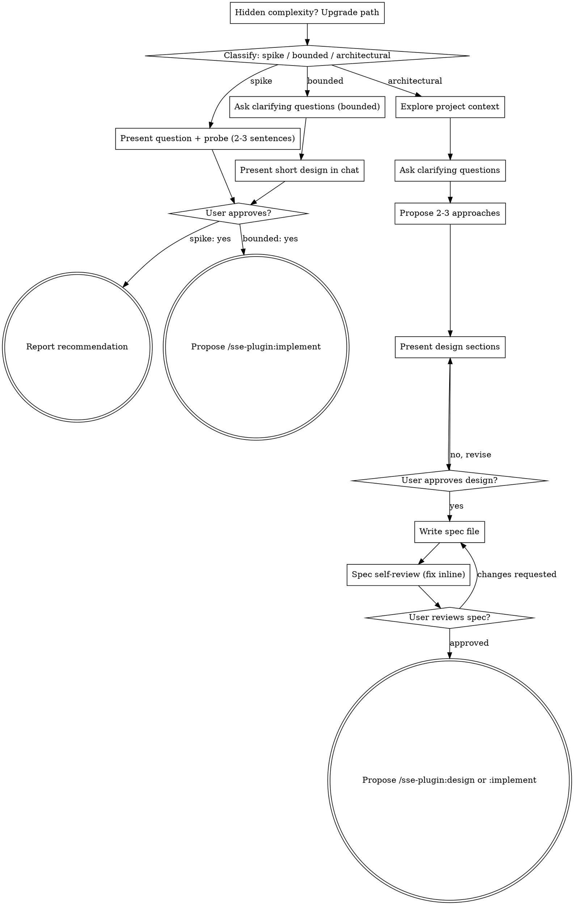

# Three paths — per-path steps, flow and depth guidance

Detail for [`../SKILL.md` → Framework and Modes](../SKILL.md#framework--three-path-classification--approval-gate).
Load when running `spike`, `bounded` or `architectural`; `diag` does not need it.

The entity **never implements**. Every path ends either in an answer (spike), an approved in-chat
design (bounded) or an approved spec file (architectural) — followed by a *proposed* next command.

## Steps per path

Classify first, announce the path in one sentence ("this looks bounded, so I'll give you a short
design here rather than write a spec"), then work the steps in order. The user may override the
classification at that moment; after work starts the path only moves up (one-way ratchet).

**Spike** — a feasibility question whose output is an answer, not code you keep.
1. Explore just enough context to frame the probe.
2. Present the question + probe plan in 2–3 sentences: what will be tried, what result answers
   it, timebox.
3. Get approval — a nod is enough.
4. Investigate by **reading** (code, docs, tests, history, official vendor docs). A probe that needs
   code or execution → propose `/sse-plugin:implement` with the probe brief, labelled **throwaway**;
   interpret the result when it comes back.
5. Report a recommendation (answer, confidence, evidence, next step). Anything built stays throwaway.

**Bounded** — a well-scoped change to a flow that already exists in this repo.
1. Explore context: files, docs, recent commits of the flow being changed.
2. Ask the clarifying questions that matter — one per message.
3. Present the short design in chat (format in SKILL.md).
4. **Stop and wait for an explicit yes.** Presenting and proceeding in the same breath skips the gate.
5. On yes → propose `/sse-plugin:implement` with the approved design as input. No spec file, no plan document.

**Architectural** — new project/subsystem, restructuring, or interfaces others depend on.
1. Explore context: files, docs, ADRs, recent commits.
2. Assess scope; decompose first if the request holds several independent subsystems.
3. Offer the visual companion **just in time** — only when a question is genuinely clearer shown
   than told; never upfront.
4. Ask clarifying questions one at a time: purpose, constraints, success criteria.
5. Propose 2–3 approaches with trade-offs; lead with the recommendation.
6. Present the design in sections scaled to complexity; get approval after each section.
7. Write the spec file from [`../assets/template-spec.md`](../assets/template-spec.md).
8. Spec self-review — [`spec-self-review.md`](spec-self-review.md); fix inline.
9. User reviews the written spec; changes → edit and re-run self-review.
10. On approval → propose `/sse-plugin:design` (ADR, contracts, diagrams) or `/sse-plugin:implement`.

## Process flow

Terminal states are path-bound and are always **proposals**; the user decides and runs them.

## Depth guidance

Spike stops at "present the probe, get a nod". For bounded work, context + a few questions + a short
in-chat design is the whole process. Everything from *Exploring approaches* down is architectural depth.

**Understanding the idea**
- Check the current project state first (files, docs, recent commits).
- Assess scope before detailed questions: a request describing several independent subsystems
  ("a platform with chat, file storage, billing and analytics") is flagged immediately — don't
  refine details of something that must be decomposed first.
- Too large for one spec → decompose into sub-projects: the independent pieces, how they relate,
  build order. Brainstorm the first one through the normal flow; each gets its own spec → hand-off.
- One question per message; prefer multiple choice, open-ended is fine.
- Focus: purpose, constraints, success criteria.

**Exploring approaches**
- 2–3 approaches with trade-offs, conversationally, recommendation first with the reason.
- YAGNI ruthlessly: remove unrequested features from every approach.

**Presenting the design**
- Present once you believe you understand what is being built.
- Scale each section: a few sentences if straightforward, up to 200–300 words if nuanced.
- Ask after each section whether it looks right.
- Cover architecture, components, data flow, error handling, testing.
- Be ready to go back and clarify.

**Design for isolation and clarity**
- Units with one clear purpose, communicating through well-defined interfaces, understandable and
  testable on their own.
- For each unit answer: what does it do, how is it used, what does it depend on?
- Can someone understand a unit without reading its internals? Can internals change without
  breaking consumers? If not, the boundaries need work (`sse-architect` can stress-test them).
- Small, focused files are also easier to reason about and edit reliably; a file that keeps growing
  is usually doing too much.

**Working in existing codebases**
- Explore the current structure first and follow existing patterns.
- Where existing problems affect the work (an oversized file, unclear boundaries, tangled
  responsibilities), include targeted improvements in the design.
- No unrelated refactoring — stay on the current goal (`sse-maintainer` / `/sse-plugin:maintain` for the rest).
